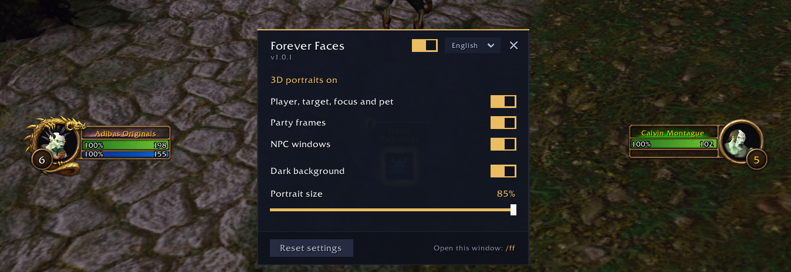

# Forever 3D Portraits

Unit frame portraits are flat, still pictures, while the rest of the game is alive.

Forever 3D Portraits turns them into animated 3D portraits: your own frame, your target, focus, pet, party and the NPCs you talk to. Built for **World of Warcraft: Forever**.

- 3D models inside the round frame, under the ring and the level badge
- Party frames and NPC windows (quests, gossip, merchants, trainers, bank and more)
- Falls back to the game's picture when a unit is dead, offline, out of sight or tinted by the game
- Adjustable portrait size and dark background
- English and Russian
- Minimap button
- Settings: `/ff`

**Install:** unzip the `ForeverFaces` folder into `World of Warcraft/_forever_/Interface/AddOns/`. If the game is already running, type `/reload`.

MIT license.

---

**RU:** живые 3D-портреты для рамок персонажа, цели, группы и NPC, с которыми говоришь. Настройки: `/ff`.
